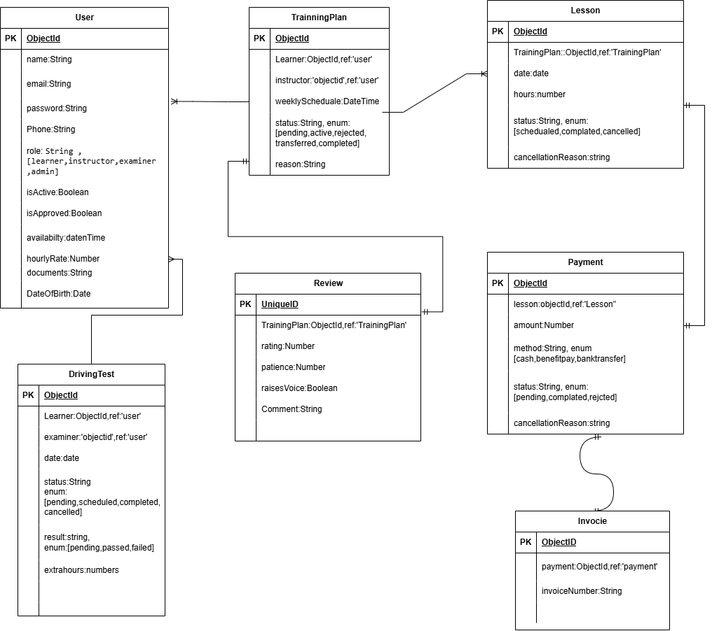

# DARBI

## Project Name
DARBI

## Overview

DARBI (دربي) is a driving training management platform designed to connect learners, driving instructors, examiners, and administrators in one simple system.

Learners can find suitable instructors, schedule driving lessons, track their training hours, manage payments, and follow their progress toward the driving test.

Instructors can manage their learners and lessons, examiners can record driving test results, and administrators can manage accounts and instructor approvals. Learners can also review instructors to help others choose the right instructor.

The name DARBI means "My Path," representing the learner's journey from their first driving lesson to passing the driving test.

## Screenshots

## Technologies Used

## Getting Started

## User Stories

### Learner
- As a learner, I want to create an account and sign in.
- As a learner, I want to find approved instructors and view their ratings, hourly rates, and availability.
- As a learner, I want to request a recurring lesson schedule with an available instructor.
- As a learner, I want to view my upcoming and completed lessons.
- As a learner, I want to cancel a lesson and provide a reason.
- As a learner, I want to request a different instructor and provide a reason without losing completed training hours.
- As a learner, I want to track my completed hours and remaining training requirements.
- As a learner, I want to submit my lesson payment for confirmation.
- As a learner, I want to download a PDF invoice after my payment is confirmed.
- As a learner, I want to request a driving test after completing the required training hours.
- As a learner, I want to view my test results and any additional hours required after a failed attempt.
- As a learner, I want to review instructors I have trained with after meeting the review requirements.

### Instructor
- As an instructor, I want to register and submit my required training documents for approval.
- As an instructor, I want to manage my profile, hourly rate, and weekly availability.
- As an instructor, I want to accept or reject learner training requests.
- As an instructor, I want to view my learners and scheduled lessons.
- As an instructor, I want to cancel a lesson and provide a reason.
- As an instructor, I want to mark completed lessons and record the actual training hours.
- As an instructor, I want to confirm or reject submitted lesson payments.
- As an instructor, I want to monitor my learners' training progress.
- As an instructor, I want to view the reviews submitted by my learners.

### Examiner
- As an examiner, I want to sign in and view driving tests assigned to me.
- As an examiner, I want to see the scheduled test date and learner information.
- As an examiner, I want to record whether a learner passed or failed a driving test.
- As an examiner, I want to record any additional training hours required after a failed attempt.

### Admin
- As an admin, I want to access a dashboard showing learner, instructor, and examiner statistics.
- As an admin, I want to review instructor registration documents.
- As an admin, I want to approve or reject instructor registrations.
- As an admin, I want to view and manage user accounts.
- As an admin, I want to activate or deactivate accounts without permanently deleting them.
- As an admin, I want to view lesson schedules and training progress.
- As an admin, I want to oversee driving test scheduling and examiner assignment.
- As an admin, I want to view instructor reviews and reported concerns.

## Database Design

## Routes

## Features

## Extra Features

## Future Enhancements

## Credits
