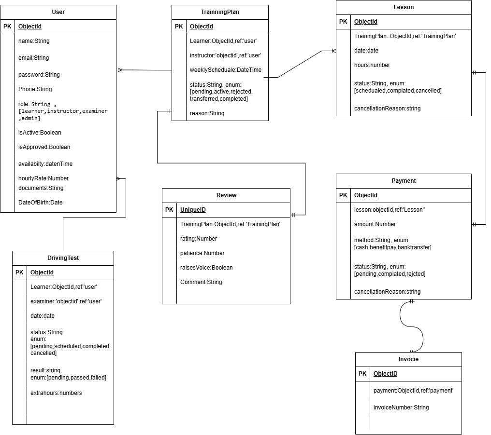

# DARBI Backend API

Backend API for **DARBI (دربي)**, a driving training management platform that connects learners, instructors, examiners, and administrators. Learners can find instructors, arrange lessons, track training hours, submit payments, request driving tests, and review instructors.

## Related repositories

- **Backend repository:** [Mohamed-ABannai/Darbi-Backend](https://github.com/Mohamed-ABannai/Darbi-Backend)
- **Frontend application:** [Mohamed-ABannai/Darbi-FrontEnd](https://github.com/Mohamed-ABannai/Darbi-FrontEnd)
- **Deployed :** Pending deployment

## Technologies

- Node.js and Express 5
- MongoDB and Mongoose
- JWT authentication and bcrypt password hashing
- dotenv, Morgan, CORS, and express-rate-limit
- Multer for in-memory image and document uploads
- PDFKit for invoice PDFs
- Jest and Supertest dependencies are configured in the project

## Features

- Role-based accounts: learner, instructor, examiner, admin, and superAdmin
- JWT sign-in, protected routes, and role/ownership checks
- Instructor approval, profile management, and learner-facing instructor listings
- Training plan requests, weekly schedules, lesson booking, cancellation, and progress tracking
- Driving test eligibility checks, examiner assignment, scheduling, and results
- Lesson payment submission and instructor confirmation or rejection
- PDF invoice generation for completed payments
- Instructor reviews with rating and feedback fields
- Request rate limiting and MongoDB-backed validation
- Instructor documents and profile images stored in MongoDB

## Project structure

```text
Darbi-Backend/
├── assets/                        
├── config/
│   └── db.js                       
├── ERD/                            
├── middleware/
│   ├── authorizeRoles.js           
│   ├── rateLimiters.js             
│   ├── validateObjectId.js         
│   └── verifyToken.js             
├── models/
│   ├── DrivingTest.js
│   ├── invoice.js
│   ├── lesson.js
│   ├── Payment.js
│   ├── Review.js
│   ├── TrainingPlan.js
│   └── User.js
├── pdf/                           
├── routes/
│   ├── auth.routes.js
│   ├── DrivingTest.routes.js
│   ├── invoice.routes.js
│   ├── lesson.routes.js
│   ├── Payment.routes.js
│   ├── Review.routes.js
│   ├── trainingPlans.routes.js
│   └── user.routes.js
├── .env                           
├── .gitignore                     
├── package-lock.json               
├── package.json        
├── README.md                      
└── server.js    

## Getting started

### Prerequisites

- Node.js and npm
- A local MongoDB instance or MongoDB Atlas connection string

### Install

```bash
git clone https://github.com/Mohamed-ABannai/Darbi-Backend.git
cd Darbi-Backend
npm install
```

Create a `.env` file in the repository root:

```env
PORT=3000
MONGODB_URI=mongodb://127.0.0.1:27017/darbi
CLIENT_URL=http://localhost:5173
JWT_SECRET=replace-with-a-long-random-secret
```

`MONGODB_URI` and `JWT_SECRET` must be set for the API to connect and issue/verify tokens. `PORT` defaults to `3000`; `CLIENT_URL` defaults to `http://localhost:5173`.

Start the development server:

```bash
npm run dev
```

Start it without nodemon:

```bash
npm start
```

The API runs at `http://localhost:3000` by default. The server connects to MongoDB before listening for requests.

## Authentication

Sign in with `POST /auth/sign-in`. Include the returned token on protected requests:

```http
Authorization: Bearer <accessToken>
```

Access is limited by role and, where applicable, resource ownership. Access tokens expire after one hour. There is no server-side logout endpoint; the client should discard its token when the user signs out.

Instructor sign-up accepts `multipart/form-data` with a `documents` file (PDF, JPEG, or PNG; maximum 5 MB). Profile updates accept a `profileImage` file (JPEG, PNG, or WebP; maximum 5 MB).

## Database models and relationships

| Model | Purpose and key fields |
|---|---|
| **User** | Username, hashed password, contact/profile information, role, active/approval flags, instructor rate and availability, uploaded documents/images. Timestamps are enabled. |
| **TrainingPlan** | Links a learner and instructor; stores weekly schedule, status, and reason. |
| **Lesson** | Belongs to a training plan; stores date, hours, status, cancellation reason, and rate/amount snapshots. |
| **Payment** | Links a lesson, learner, and instructor; stores amount, method, and payment status. |
| **DrivingTest** | Links a learner and optional examiner; stores date, status, result, and additional required hours. |
| **Invoice** | Belongs to a payment (one invoice per payment); stores date, amount, and status. |
| **Review** | Belongs to a training plan (one review per plan); stores ratings and optional feedback. |

The user model uses `hashedPassword` (excluded from normal query results), rather than storing a plaintext password. User and related models use Mongoose timestamps where configured.

### Entity relationship diagram



## API reference

The API currently mounts its route groups at the root (for example, `/auth` and `/users`); it does not use an `/api` prefix. Unless marked public, endpoints require a Bearer token. The server currently exposes the following routes:

### Authentication — `/auth`

| Method | Endpoint | Access | Description |
|---|---|---|---|
| `POST` | `/auth/sign-up` | Public | Register a learner or instructor. Instructor registration includes a document upload. |
| `POST` | `/auth/sign-in` | Public, rate limited | Authenticate and return a one-hour access token and user summary. |
| `POST` | `/auth/create-admin` | superAdmin | Create an admin account. |

### Users — `/users`

| Method | Endpoint | Access | Description |
|---|---|---|---|
| `GET` | `/users` | Authenticated | Learners see approved active instructors; admins see users. |
| `GET` | `/users/:id` | Authenticated, owner/admin or public instructor profile | Get an authorized user profile. |
| `PUT` | `/users/:id` | Owner/admin | Update profile; admins can manage account activity and instructor approval. |
| `DELETE` | `/users/:id` | Owner/admin | Deactivate an account (soft delete). |
| `GET` | `/users/:id/image` | Authenticated | Retrieve a profile image. |
| `GET` | `/users/:id/documents` | Owner/admin | Retrieve a user's uploaded documents. |
| `GET` | `/users/examiners` | Admin/superAdmin | List examiners. |
| `POST` | `/users/examiners` | Admin/superAdmin | Create an examiner. |
| `GET` | `/users/examiners/:id` | Admin/superAdmin | Get examiner details. |
| `PATCH` | `/users/examiners/:id/status` | Admin/superAdmin | Change an examiner's active status. |

### Training plans — `/training-plans`

| Method | Endpoint | Access | Description |
|---|---|---|---|
| `GET` | `/training-plans` | Authenticated | List plans visible to the current role/user. |
| `GET` | `/training-plans/:id` | Plan participant/admin | Get a plan and its schedule. |
| `POST` | `/training-plans` | Learner | Request a plan with an approved, active instructor. |
| `PUT` | `/training-plans/:id` | Plan learner/instructor | Update a pending schedule, accept/reject a request, or transfer to another instructor. |

### Lessons — `/lessons`

| Method | Endpoint | Access | Description |
|---|---|---|---|
| `GET` | `/lessons` | Authenticated | List lessons visible to the current role/user. |
| `POST` | `/lessons` | Learner | Request a lesson under an active training plan. |
| `PUT` | `/lessons/:id` | Plan learner/instructor | Accept, reject, cancel, or complete a lesson. |

### Driving tests — `/driving-tests`

| Method | Endpoint | Access | Description |
|---|---|---|---|
| `GET` | `/driving-tests` | Authenticated | List tests visible to the current role/user. |
| `GET` | `/driving-tests/eligibility` | Learner | Check completed/required training hours and test eligibility. |
| `POST` | `/driving-tests` | Learner | Request a test; the API assigns an available examiner. |
| `PUT` | `/driving-tests/:id` | Role/ownership dependent | Cancel, schedule, or record a test result and extra hours. |

### Payments — `/payments`

| Method | Endpoint | Access | Description |
|---|---|---|---|
| `GET` | `/payments` | Authenticated | List payments visible to the current role/user. |
| `POST` | `/payments` | Learner | Submit a payment method for a completed lesson. |
| `PUT` | `/payments/:id` | Payment owner/instructor/admin as applicable | Update payment details or confirm/reject a submitted payment. |

### Invoices — `/invoices`

| Method | Endpoint | Access | Description |
|---|---|---|---|
| `GET` | `/invoices/:id/pdf` | Authorized payment participant/admin | Generate and download a PDF invoice for a completed payment. |

### Reviews — `/reviews`

| Method | Endpoint | Access | Description |
|---|---|---|---|
| `GET` | `/reviews` | Authenticated | List reviews, with optional instructor filtering. |
| `GET` | `/reviews/:id` | Authorized user/admin | Get a review. |
| `POST` | `/reviews` | Learner | Review an instructor after completing a lesson on the plan. |
| `PUT` | `/reviews/:id` | Review owner | Update a review. |
| `DELETE` | `/reviews/:id` | Review owner/admin | Delete a review. |

## Common response status codes

| Status | Meaning |
|---|---|
| `200` | Request succeeded |
| `201` | Resource created |
| `400` | Invalid input or invalid state transition |
| `401` | Missing or invalid authentication token |
| `403` | Authenticated user lacks access or account is inactive |
| `404` | Resource not found |
| `409` | Conflict, such as a duplicate username or unavailable time slot |
| `429` | Rate limit exceeded |
| `500` | Unexpected server error |

Response bodies and error message keys can vary by endpoint. The API uses a 15-minute general request limit and a stricter sign-in limit of five unsuccessful attempts per 15 minutes.

## Testing

The package provides a Jest test command:

```bash
npm test
```

Jest and Supertest are configured as development dependencies. No automated test files or dedicated test database are currently included in this repository.

## Future Enhancements

- **Smart Lesson Scheduling:** Improve instructor availability management and prevent overlapping lesson bookings.
- **Real-Time Notifications:** Notify users when training requests, lesson bookings, payments, or driving-test results are updated.
- **Online Payment Integration:** Support secure online payments through a payment gateway such as BenefitPay.
- **Training Progress Tracking:** Provide detailed progress reports showing completed hours, remaining requirements, and lesson history.
- **Driving Test Management:** Improve examiner assignment based on availability and workload instead of random selection.
- **Advanced Search and Filtering:** Allow learners to filter instructors by availability, hourly rate, ratings, and experience.
- **Automated Testing:** Expand Jest and Supertest tests to cover booking workflows, payments, authentication, and role-based permissions.
- **Reports and Analytics:** Generate summaries of instructor performance, learner progress, payment records, and driving-test pass rates.

## Team

| Name | GitHub | Contribution |
|---|---|---|
| Mohamed A. Bannai | [Mohamed-ABannai](https://github.com/Mohamed-ABannai) | Project collaboration |
| Amir Alsharabi | [amirAlsharabi](https://github.com/amirAlsharabi) | Project collaboration |
| Yusuf | [YHM9205](https://github.com/YHM9205) | Project collaboration |

## Credits

Created as a collaborative project by the DARBI team.